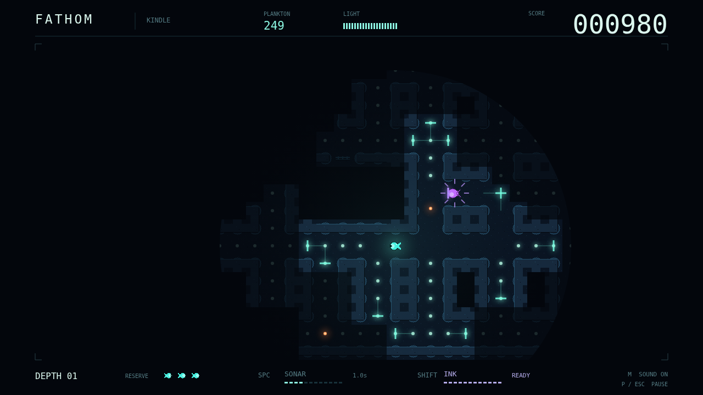

# Fathom

There is no sunlight down here. Just a small forager, a flooded maze, and the
cold glow of the next meal. Swim the corridors and graze their plankton clean to
descend into deeper water. Each mouthful widens your view—and makes you easier
to find.

Your light remembers what it touches, but the Kindle dive lets you see that
memory only through the circle you carry. Send a cyan sonar pulse around a bend
to feel out the passages ahead. Watch it trace the rock, catch a hunter in its
crest, and vanish into a darkness that is never quite empty.

Three predators read three different signals. Lanternjaw follows your light,
disguised as an innocent amber jelly until its jaws show. Eyeless Gloamfin hears
your sonar and answers with violet pings of its own. Flarefish lights the maze
with a warm bloom that sees straight through stone. Break sight, turn sharply,
or leave ink in your wake; each escape asks you to understand what is hunting
you.

Eat the last mote, collect the clear bonus, and take another breath before the
next descent. More hunters wait below, and your sonar reaches a little less
far. Every passage is a choice between seeing enough to survive and shining
enough to be found.

